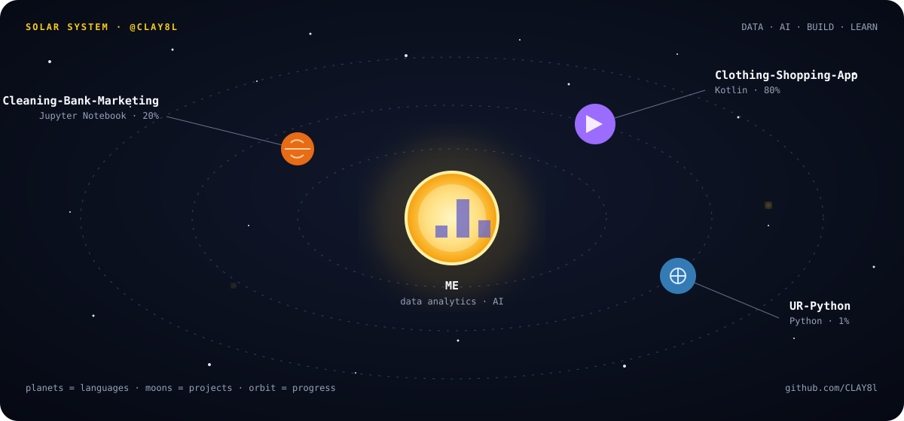

  

  <strong>I am the sun; my languages are the planets and my projects their moons.</strong>

<table>
  <tr>
    <td width="50%" valign="top">
      <h3>🌙 MOON 01</h3>
      <h4><a href="https://github.com/CLAY8l/Cleaning-Bank-Marketing-Campaign-Data">Cleaning Bank Marketing Campaign Data</a></h4>
      
Tidy a bank marketing dataset by splitting it into subsets, updating values, converting data types, and storing the results as CSV files.

      
<code>★ 3</code> · <code>Jupyter Notebook</code>

    </td>
    <td width="50%" valign="top">
      <h3>🌙 MOON 02</h3>
      <h4><a href="https://github.com/CLAY8l/Clothing-Shopping-App">Clothing Shopping App</a></h4>
      
A modern Android e-commerce app built with Jetpack Compose, Room Database, Firebase, and MVVM architecture.

      
<code>Kotlin</code> · <code>Android</code> · <code>Firebase</code>

    </td>
  </tr>
</table>

### 🪐 PLANETS

| Planet | Orbit strength |
|:--|:--|
| 🟪 **Kotlin** | `████████████████████` 80% |
| 🟧 **Jupyter Notebook** | `█████░░░░░░░░░░░░░░░` 20% |
| 🟦 **Python** | `█░░░░░░░░░░░░░░░░░░░` 1% |

### 🛰️ ORBIT LOG · 26 WEEKS

<table>
  <tr>
    <td width="58%">
      
    </td>
    <td>
      <strong>DAYS IN ORBIT</strong> 
      <strong>0 days</strong>  
      <strong>LONGEST ORBIT</strong> 
      <strong>1 day</strong>  
      <strong>REVOLUTIONS THIS YEAR</strong> 
      <strong>28</strong>
    </td>
  </tr>
</table>

### 👨‍🚀 ABOUT THE ASTRONAUT

- 🎓 Studying **Data Analytics and Artificial Intelligence**
- 🌱 Learning **Machine Learning** and **Deep Learning**
- 💡 Turning real-world problems into data-driven solutions
- 🎯 Growing toward a career as a **Data Scientist** and **AI Engineer**

### 🧰 MISSION CONTROL

  

### 📡 TRANSMISSION

  
  

  <em>“Data is the new oil, but analytics is the combustion engine.”</em>

